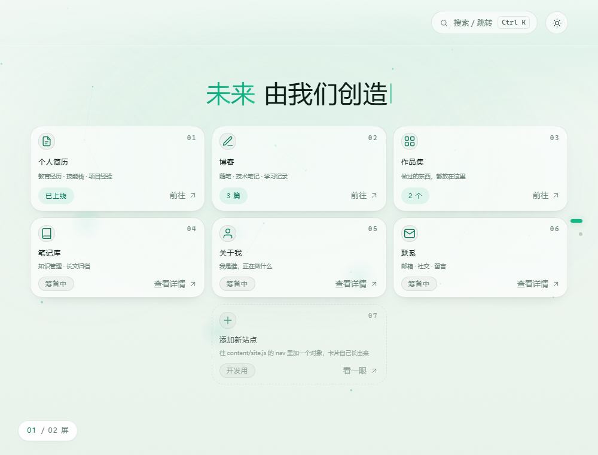
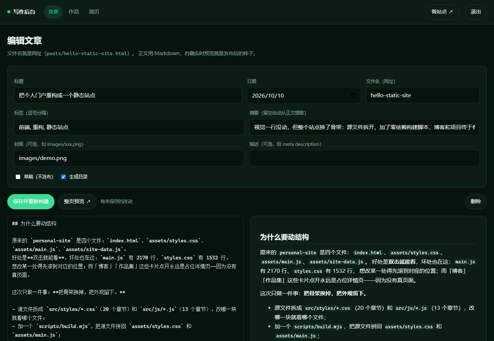

# 个人门户 · personal-site

一个**导航门户**：第一屏就是导航本身 —— 一句主标语压在上面，下面整墙铺开
简历 / 博客 / 作品集 / 笔记库这些入口。点卡片不弹小浮层，而是**从右侧滑进一整屏详情页**。

风格：简约 · 高级 · 清新绿。两套主题，一屏一页。

这个仓库同时是三样东西：

| | 是什么 | 关键点 |
|---|---|---|
| **一个静态网站** | 门户首页 + 博客 + 作品集 + 简历 + 标签页 | 零依赖、无外部请求，**双击 `index.html` 就能看**，离线也能看 |
| **一条内容管线** | Markdown 写 → 构建成静态页 + RSS + sitemap + 搜索索引 | 只用 Node 内置模块，服务器上不需要 `node_modules` |
| **一个可选的写作后台** | 浏览器里写内容、实时预览、保存即发布 | 独立进程，**挂了不影响站点**（站点始终是静态的） |



三条不打算妥协的原则：

- **零外部请求**：没有 CDN、没有外部字体、没有第三方脚本。首屏一次网络请求都没有。
- **双击能开**：产物就是普通文件，`file://` 下直接能跑，不依赖任何服务器。
- **一屏一页，页面本身锁死不滚**：翻屏是整块面板在原地换，不是把页面滚上去；
  博客 / 作品 / 简历是长页面，走另一套骨架（见「两套布局」）。

---

## 快速开始

```bash
cd personal-site

node scripts/build.mjs        # 改完内容后构建（本文档里所有命令都零依赖）
node scripts/check.mjs        # 上线前自检：死链、遗漏的占位符、产物完整性
node scripts/serve.mjs        # 本地预览 → http://127.0.0.1:8000

ADMIN_PASSWORD=你的密码 npm run admin    # 可选的写作后台 → http://127.0.0.1:8787/admin
bash scripts/deploy.sh                   # 构建 → 自检 → 同步到服务器（见 DEPLOY.md）
```

**只想看看长什么样？** 直接双击 `index.html`，不用跑上面任何一条命令。

---

## 我该改哪里

| 我想改… | 去哪 |
|---|---|
| 首页标语、导航卡片、开关、每页文章数 | `content/site.js` |
| 写一篇文章 | `content/posts/*.md`（**文件名就是网址**） |
| 加一个作品 | `content/projects/*.md` |
| 简历 | `content/resume.json` |
| 正文里的图片 | 放进 `content/images/`，正文写 `` |
| 颜色、间距、圆角 | `src/styles/01-design-tokens.css` |
| 首页某个模块的样式 | `src/styles/` 下对应章节（09 首屏 / 11 卡片 / 13 详情页 …） |
| 首页交互（粒子、转场、命令面板） | `src/js/` 下对应章节（04 粒子 / 09 舞台 / 10 命令面板 …） |
| 长页面（博客/作品/简历）的样式 | `src/styles/21-pages.css` |
| 构建产出的页面长什么样 | `scripts/build.mjs` + `scripts/lib/templates.mjs` |
| 写作后台 | `admin/` |
| 没做的事、以后想加什么 | **[TODO.md](TODO.md)** —— 每条都写了要动哪个文件的哪一段 |

> 改完 `src/` 或 `content/` 里的东西，**都要跑一次 `node scripts/build.mjs`**，
> 因为仓库里的 `index.html`、`assets/`、`blog/` 等都是**构建产物**（提交进版本库，
> 这样别人 clone 下来双击就能看）。

---

## 目录结构

```
personal-site/
├─ index.html              门户首页          ┐
├─ blog/                   博客列表 + 文章    │
├─ projects/               作品列表 + 详情    │ 构建产物：
├─ tags/                   标签云 + 标签页    │ 由 content/ 和 src/ 生成，
├─ resume.html             简历              │ 可以整个删掉重建
├─ 404.html                404 页            │
├─ sitemap.xml rss.xml robots.txt            │
├─ assets/                 styles.css / main.js / pages.js /
│                          site-data.js / site-index.js / images/
│
├─ content/                ← 写内容只动这里
│  ├─ site.js              站点配置：标语、开关、导航卡片、每页文章数
│  ├─ posts/*.md           博客文章
│  ├─ projects/*.md        作品
│  ├─ images/**            正文图片
│  └─ resume.json          简历
│
├─ src/                    ← 改视觉/交互动这里
│  ├─ styles/*.css         22 个章节，按清单拼成 assets/styles.css
│  ├─ js/*.js              15 个章节，按清单拼成 assets/main.js
│  ├─ js/pages.js          长页面用的小脚本 → assets/pages.js
│  └─ pages/index.html     门户首页的源文件（构建时注入主题脚本与版本串）
│
├─ scripts/
│  ├─ build.mjs            构建主程序
│  ├─ check.mjs            上线前自检
│  ├─ serve.mjs            本地预览（行为对齐 nginx）
│  ├─ deploy.sh            构建 → 自检 → rsync
│  └─ lib/                 渲染器：Markdown / 代码高亮 / 图片 / 模板 / 配置
│
├─ admin/                  写作后台（独立进程，可选）
│  ├─ server.mjs           登录、路由、静态服务、保存后重建
│  └─ lib/                 内容读写 / 服务端渲染 / 界面
│
├─ deploy/                 nginx 配置、systemd 单元、部署配置示例
├─ proto/                  爆点与标题消散的对照原型页（不属于正式页）
├─ DEPLOY.md               部署到云服务器的完整步骤
└─ TODO.md                 没做的事 + 以后怎么加
```

---

## 写内容

### 站点配置 `content/site.js`

首页唯一需要改的文件。

```js
window.SITE = {
  brand: '个人门户',
  author: 'Jerry',
  url: 'https://your-domain.com',   // 部署前必改：sitemap / RSS / canonical 用它拼绝对地址
  description: '首页描述，分享卡片和搜索引擎用',
  tagline: '未来 由我们创造',        // 首屏那行大字，点一下散成粒子

  postsPerPage: 10,                 // 博客列表每页几篇，超出自动分页
  ogImage: '',                      // 分享卡片默认图（可选）

  showAddCard: true,                // 是否显示「＋ 添加新站点」开发卡
  randomTransition: true,           // 翻屏六套转场随机
  randomBurst: true,                // 点击爆点两套随机
  randomTheme: true,                // 首次打开随机亮/暗

  nav: [ /* 导航卡片，见下 */ ]
};
```

加一张卡片 = 往 `nav` 里加一个对象：

```js
{
  title: '博客',
  desc: '随笔 · 技术笔记 · 学习记录',
  icon: 'pen',                    // 图标名见 src/js/08-cards.js 顶部的 ICONS
  href: 'blog/index.html',        // 留空 = 卡片显示「筹备中」，点开是详情页
  badge: '{{posts}}',             // {{posts}} / {{projects}} / {{resume}} 由构建换成真实数量
  tags: ['博客', 'blog', '文章'],   // 命令面板搜得到
  details: ['随笔：想到哪写到哪', '技术笔记：踩过的坑 + 解决过程']  // 悬停预览露两条，详情页看全部
}
```

`href` 填上之后卡片自动变成真链接：站内写 `blog/index.html`，外链写完整 `https://`，
邮箱写 `mailto:…`。

> 站内链接**写 `blog/index.html` 而不是 `blog/`** —— 后者在 `file://` 下会变成目录列表。

### 写一篇文章 `content/posts/hello.md`

文件名就是网址：`content/posts/hello.md` → `/blog/hello.html`。
建议**文件名用英文或拼音、标题写中文**（中文文件名能跑，但 URL 会被百分号编码）。

```markdown
---
title: 文章标题
date: 2026-10-10
tags: [前端, 笔记]
excerpt: 列表页和分享卡片上显示的一句话。不写就从正文自动提取。
cover: images/demo.png     # 可选，文章顶部大图 + 分享图
draft: false
---

正文用 Markdown 写。支持**粗体**、*斜体*、`行内代码`、[链接](https://…)、
图片、列表、引用、代码块（带高亮）、表格、脚注[^1]。

[^1]: 脚注定义写在文末。
```

支持的语法：标题（自动生成锚点和目录）、粗体 / 斜体 / 删除线、行内代码、链接、图片、
裸网址自动转链接、有序 / 无序 / 嵌套列表、引用、围栏代码块（构建时高亮）、GFM 表格、
分隔线、脚注。

正文里的 HTML **默认会被转义**（安全考虑）。确实要直出就写 `html: true` —— 风险自负。

### 加一个作品 `content/projects/项目名.md`

```markdown
---
title: 项目名
description: 一句话说明（列表卡片用）
date: 2026-09-30
tech: [Node.js, Markdown]          # 会生成对应的标签页
demo: https://demo.example.com
repo: https://github.com/you/repo
featured: true                     # 列表里打个 Featured 标记
order: 1                           # 数字越小越靠前
---
```

正文同样用 Markdown，会在详情页完整显示。

### 简历 `content/resume.json`

```json
{
  "intro": "一段自我介绍。",
  "sections": [
    { "type": "skill", "title": "技能栈", "en": "Skills",
      "items": [{ "name": "TypeScript", "level": "熟练" }] },
    { "type": "timeline", "title": "经历", "en": "Experience",
      "items": [{ "role": "前端工程师", "company": "某公司", "period": "2024 — 至今", "description": "做了什么" }] }
  ]
}
```

教育背景也用 `timeline`，多写 `major` / `degree` 两个字段即可。

### 图片

放进 `content/images/`，正文写相对路径：

```markdown

```

构建时会拷到 `assets/images/`，并**自动补上 `width` / `height`**
（支持 PNG / JPEG / GIF / WebP / SVG），图片加载时页面不会跳。

### 草稿

front-matter 写 `draft: true`：默认构建**完全不生成**这一页，也不进列表 / RSS /
sitemap / 搜索索引。本地想看就：

```bash
node scripts/build.mjs --drafts
```

生成的页面会带「草稿」标记和 `noindex`。

---

## 命令

```bash
node scripts/build.mjs            # 完整构建（增量：没变的文件不会重写）
node scripts/build.mjs --drafts   # 连草稿一起生成
node scripts/build.mjs --assets   # 只重拼 CSS/JS/配置（调样式时最快，发布前别用）
node scripts/build.mjs --force    # 忽略增量缓存，全部重算重写
node scripts/check.mjs            # 上线前自检
node scripts/serve.mjs            # 本地预览 http://127.0.0.1:8000
bash scripts/deploy.sh            # 构建 → 自检 → 同步到服务器
bash scripts/deploy.sh --dry-run  # 只看会传哪些文件
```

有 `package.json` 但**一个依赖都没有**，只是为了少打几个字：

```bash
npm run build | assets | check | serve | deploy | admin
```

### 构建是增量的

- **内容没变的文件不落盘**：mtime 不变 → `rsync` 只传真正改过的那几个文件；
- **Markdown 渲染结果有缓存**（`.build-cache/`，按内容 + 渲染器版本做 key）；
- 删掉一篇文章，它的页面和标签页会被**自动清掉**（构建收尾时对比产物清单）。

实测：没有改动时「落盘 0 个文件，跳过 32 个没变的」。

### 为什么是"拼接"而不是打包器

站点要能在 `file://` 下双击打开，所以不能用 ES module、不能有外部依赖。
源文件拆开只为好读好改；构建脚本只做四件事：拼接、渲染 Markdown、写页面、写 SEO 产物，
全部只用 Node 内置模块。**服务器上只要有 Node 就能构建**，不需要 `npm install`，
也没有依赖升级把构建搞坏的风险。

---

## 内容能力

这些都是构建时自动生成的，写的时候不用管。

| 能力 | 怎么用 | 产物 |
|---|---|---|
| **标签页** | 文章写 `tags:`、作品写 `tech:` | `tags/index.html` 标签云 + 每个标签一页；文章页上的标签是可点链接 |
| **分页** | `content/site.js` 的 `postsPerPage` | 超过就生成 `blog/page2.html`…，带页码导航；第 2 页起 `noindex` |
| **全文搜索** | 什么都不用做，`Ctrl/⌘+K` 里搜标题 / 摘要 / 标签 | 生成 `assets/site-index.js`，命令面板**第一次打开时**才按需加载，不拖慢首屏 |
| **目录** | 文章里有 3 个以上 `##`/`###` 就自动出现 | 文首的目录卡片；不想要写 `toc: false` |
| **脚注** | 正文 `[^1]` + 文末 `[^1]: 内容` | 上标引用 + 文末列表，带「↩ 回到正文」 |
| **代码高亮** | 代码块写语言名 | 构建时生成高亮标签；配色仍落在站点的墨绿灰阶里，不加彩虹色 |
| **封面 / 分享图** | 文章 `cover:`，站点默认图 `ogImage` | 文章顶部大图 + `<meta property="og:image">`（绝对地址） |
| **SEO** | 自动 | 每页 title / description / canonical / OG + JSON-LD + `sitemap.xml` + `rss.xml` + `robots.txt` |
| **CI** | 推代码自动跑 | `.github/workflows/ci.yml`：构建 + 自检 + **确认产物和源一致**（改了内容忘了构建会红） |

---

## 写作后台（可选）

浏览器里写内容的那个后台。**它是独立进程，跟对外站点没关系**：站点始终是纯静态的，
nginx 直接发文件；后台挂了、停了，站点照常访问。



```bash
ADMIN_PASSWORD=你的密码 npm run admin      # → http://127.0.0.1:8787/admin
```

| 它能做 | 怎么做的 |
|---|---|
| 增删改文章 / 作品 | 直接读写 `content/` 里的 `.md`；原子写（先写 `.tmp` 再 rename） |
| 改简历 | 编辑 `content/resume.json`，保存前校验 JSON |
| **实时预览** | 每敲几下把正文发给服务端，用**构建脚本同一套渲染器**渲染 → 不会"预览挺好、发布变形" |
| **整页草稿预览** | `/preview/posts/<文件名>` 渲染完整页面（带 `noindex`），不发布也能看真实排版 |
| 保存即发布 | 保存后自动跑一次增量构建，构建日志直接显示在编辑器里 |
| 密码登录 | `httpOnly` 会话 cookie + 失败限流 + 同源校验 |

两条硬规定：

1. **只监听 `127.0.0.1`**，对外一律经 nginx 反代（`deploy/nginx.conf` 里已配好）；
2. 后台端口的静态文件服务是**白名单** —— 只发站点公开文件，
   `content/`、`admin/`、`.git/`、`package.json` 一律 404。

部署步骤看 [DEPLOY.md](DEPLOY.md) 第 7 节。**不用后台也完全没问题**：
内容就是 `content/` 里的文件，用任何编辑器写都行。

---

## 首页交互一览

| 你做什么 | 它怎么回应 |
|---|---|
| 滚轮 / 空格 / `↓` | 翻到下一屏（**页面不动**，内容在原地换） |
| `↑` / `PgUp` | 上一屏 |
| `1` `2` | 直接跳到第 N 屏 |
| 右侧圆点 / 左下角屏序 | 点圆点跳屏；屏序旁边写着这一屏用了哪套转场 |
| 拖动空白处 | 屏幕跟手挪一点点，松手看距离和速度：够就翻屏，不够就弹回去（有惯性） |
| 点一下大标题 | 整行字**散成粒子、撒满整个屏幕**，约两秒后逐字聚回来；散着的时候再点没反应 |
| 点任意空白 | **爆点**：把周围的粒子轰开，同时炸一下 |
| `Ctrl` / `⌘` + `K` | **命令面板**：搜页面、搜卡片、**搜文章 / 作品 / 标签**、执行动作 |
| `?` | 全部快捷键与互动一览 |
| `T` | 明 / 暗主题（从按钮位置圆形揭开） |
| 悬停卡片 | 停 0.42 秒出预览：这条目的前两条详情 |
| 点卡片 | 填过 `href` 的直接跳走；没填的**从右侧滑进整屏详情页** |
| 详情页开着时 | 滚轮、方向键、数字键都不会穿透去翻底下的屏 |

### 三样东西是随机的

| 随机的 | 开关（都在 `content/site.js`） | 网址钉死 |
|---|---|---|
| **翻屏转场**：六套（淡入 / 推移 / 翻卡 / 缩放 / 虚化 / 擦除），不连着重复 | `randomTransition` | — |
| **点击爆点**：两套，每次点击**独立**掷一次 | `randomBurst` | `?fx=random` / `?fx=new` / `?fx=classic` |
| **主题**：首次打开随机亮 / 暗，手动切过一次就记住 | `randomTheme` | `?theme=light` / `?theme=dark` |

两套爆点长什么样、想看左右对照，开 `proto/burst-lab.html`。

---

## 两套布局

| | 门户首页 | 博客 / 作品 / 简历 / 标签 |
|---|---|---|
| `<html>` 标记 | `data-layout="stage"` | `data-layout="page"` |
| 文档滚动 | **锁死不滚**（`overflow: hidden`） | 正常长页面滚动 |
| 骨架 | 舞台 + 面板 + 详情层 | 顶栏 + 正文 + 页脚 |
| 脚本 | `assets/main.js`（粒子 / 转场 / 命令面板） | `assets/pages.js`（只有主题和年份） |
| 样式 | 同一份 `assets/styles.css` | 同一份 `assets/styles.css` |

两者共用同一套设计令牌和同一份样式表，所以点进博客页不会有"换了个网站"的感觉。

**主题是整站统一的**，这一点当初踩过坑，现在是这么做的：

- 首绘前定主题的脚本由构建注入（`scripts/lib/templates.mjs` 的 `themeBootScript()`），
  首页和所有长页面用的是**同一份**，不会两边逻辑走偏；
- 优先级：`?theme=` ＞ `localStorage`（手动选过）＞ `sessionStorage`（本标签页掷出的随机结果）
  ＞ 随机（`randomTheme`）＞ 系统偏好；
- 随机结果记进 `sessionStorage`：**同一标签页内**从首页点进博客、再点进简历，主题都一致；
  换个标签页才重新掷 —— 这才符合「首次打开随机」的本意；
- 切换方式也统一：都走 `document.startViewTransition` 的**圆形揭示**，从按钮位置揭开；
  不支持该 API 或用户要求减弱动效时直接切换。

> ⚠ `portal-theme` / `portal-theme-session` 这两个 key 在三处出现
> （`scripts/lib/templates.mjs`、`src/js/03-theme.js`、`src/js/pages.js`），改必须三处一起改。

---

## "页面不滚"是怎么做到的

一句话：**文档被锁死成 `height:100%; overflow:hidden`，翻屏从头到尾没碰过 `window.scrollTo`。**

```
body
├─ div.bg                     固定铺满视口：色洗 + 粒子 + 光斑 + 颗粒
├─ main.stage                 固定铺满视口，overflow:hidden
│  ├─ section.panel#home      ← 两块面板叠在同一格里
│  └─ section.panel#about        只有一块 .is-active（可见 + 可交互）
└─ section.item-page          详情页：默认为 translateX(100%)，加 .is-in 滑到位
```

翻屏 = 给走的那块加 `.is-out`、来的那块加 `.is-in` + 一个转场类，动画结束把类摘掉。
方向写在 `.stage[data-dir]` 上，CSS 里的 `--push / --rot / --ct / --cb` 随方向变，
所以六套动效都只写一遍。

**某一屏真的装不下怎么办？** 三步，不推翻版式：

1. **先收紧**：每块面板有紧凑系数 `--k`（1 → 0.64，每次减 0.06），JS 一档一档调，
   字号、间距、卡片高度跟着缩；
2. **再屏内滚**：`--k` 到底还排不下（手机上的卡片墙就是这种），只让**那一屏内部**滚，
   文档仍然一动不动，左下角屏序旁挂一个「↕ 屏内可滚」；
3. **到边界才翻屏**：屏内滚到底之后，再滚一下才翻到下一屏。

> 一个容易踩的坑：`--k` 只在面板里定义。长页面没定义 `--k` 时，
> `calc(28px * var(--k))` 这种声明会**整条失效**（不是变成 0），所以长页面必须显式写 `--k: 1`。

---

## 几个刻意的设计选择

- **不加载任何外部字体**：用系统字体栈（Segoe UI / 微软雅黑 / PingFang）。
  代价是各平台字形略有差异，换来的是**首屏零网络请求**、离线可用、不会被墙。
- **绿色只用在几个地方**：光晕、主按钮、标题里「未来」两字、卡片聚光、屏序。
  其余全是低饱和的墨绿灰阶 —— 「清新」靠留白和色相，「高级」靠克制。
  长页面的代码高亮也守这条：只有深浅和字重差异，不加彩虹色。
- **颗粒质感**：背景叠了一层 3.5% 的噪点（纯 CSS 内联 SVG），防止大面积渐变色带。
- **能点的字不许选中**：整站 `user-select: none`。真正要复制的地方只留两处：
  命令面板的输入框、详情页 / 长页面的正文。
- **大字只动一下**：首屏标题不拖、不位移，唯一的互动是「点一下散成粒子」。
- **详情页是整屏滑入**，不是卡片上弹小面板：不用算坐标、不用铺遮罩，
  也不打断「一屏一页」的节奏；底下舞台的状态原样保留。
- **转场宁短不长**：最长 720ms，翻屏锁在转场期间，避免连点滚轮把状态搞乱。
- **内容就是文件**：没有数据库、没有后台服务（写作后台是可选的独立进程）。
  你的内容永远是几个能直接读、能 git diff、能随时搬走的纯文本。

### 性能账（每一条都有实测）

| 事项 | 之前 | 现在 |
|---|---|---|
| **连线**：每帧要算多少对粒子（320 颗） | 48828 次距离计算 | **3186 次（15×）**，连出来的线一模一样多 |
| **小圆点**：散开时每帧的画布 `fill()` | ~297 次 | **11 次（27×）** |
| **柔和光斑**：每帧新建的渐变对象 | 12 个/帧 | 1 张预渲染贴图，缩放贴上 |
| **指针位置写样式** | 每帧 2 次 | 变了才写，且降到 30Hz |
| **颗粒层混合面积** | 4 倍视口 | 1 倍视口 |
| **点击涟漪** | 每次点击新建一个最大 2600×2600px 的 DOM 层 | 画布上的几个圆、几条线 |

做法就三条：**别做平方级的事**（粒子按连线半径装进网格，只比同格 + 邻格）、
**绘制调用要合并**（按颜色 × 透明度档攒路径，一次 `fill`）、
**别每帧做无用功**（值没变就不写样式、不新建渐变对象）。

> 哪些是量出来的、哪些是推理出来的：表里的数字都是量出来的；
> **没量的是帧时间** —— 无头软渲染环境里的噪声比差别还大，
> 「到底还卡不卡」只能在自己的机器上感受。`proto/burst-lab.html` 就是为这个准备的。

---

## 部署

站点是纯静态的：服务器上不需要 Node、数据库或常驻进程，**一个 nginx 就够**。

**完整步骤见 [DEPLOY.md](DEPLOY.md)**：改域名 → 构建 → 上传 → nginx 配置 → HTTPS →
写作后台（可选）→ 日常发布 → 回滚备份 → 常见问题。

仓库里备好了：

- `deploy/nginx.conf` —— 缓存策略（HTML `no-cache` / 资源 `?v=` 长缓存）、gzip、404、安全头；
- `deploy/personal-site-admin.service` —— 写作后台的 systemd 单元；
- `scripts/deploy.sh` —— 构建 + 自检 + rsync 一条命令。

---

## 兼容与已知边界

| 事项 | 说明 |
|---|---|
| 浏览器 | 现代 Chromium / Safari 15.4+ / Firefox 121+（用到 `translate` 属性、`clip-path` 转场等） |
| `file://` 直接打开 | 可以。全部是传统 `<script>`，没用 ES module（module 在 `file://` 下会被 CORS 拦） |
| **改了文件页面却没变** | 静态资源有浏览器缓存，先 `Ctrl+F5`。线上不会：HTML 是 `no-cache`，CSS/JS 带 `?v=` 版本串 |
| 禁用 JavaScript | 首页退回普通长页面，两屏竖着排、内容都在，只是没有转场 / 详情页 / 互动 |
| `prefers-reduced-motion` | 全部动效退化为直出（详情页直接出现/消失），导航照常 |
| 触屏 / 触控笔 | `(pointer: coarse)` 时关掉 3D 倾斜、旧爆点的 DOM 圆，新爆点的火星减量 |
| 手机 | 首屏单列卡片 + 屏内滚动；翻屏用圆点；详情页整屏可滚，向右滑返回 |
| 中文文件名 | 能跑，但 URL 会被百分号编码。文章/标签都建议用英文或拼音 |
| Markdown | 自写的渲染器，不做 CommonMark 全兼容；正文 HTML 默认转义 |
| 构建 | 需要 Node 18+。**服务器上不需要 Node** —— 构建在本地做，只上传产物（用写作后台时才需要服务器上有 Node） |
| 别往产物目录放手工文件 | `blog/` `projects/` `tags/` `assets/images/` 由构建全权管理，不是它产出的文件会被当旧产物清掉 |

---

## 相关文档

| 文件 | 内容 |
|---|---|
| [DEPLOY.md](DEPLOY.md) | 部署到云服务器的完整步骤，含写作后台与安全措施 |
| [TODO.md](TODO.md) | 没做的事：明确没加的视觉交互、可以再加的能力、按设计不做的取舍 |
